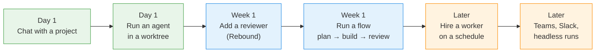

# The Overcli guide

Overcli is a desktop app that sits *over* the coding CLIs you already use — `claude`, `codex`, `gemini`, `copilot` and `ollama`. It adds no model and holds no API key. What it adds is one window for all of them, and a way to keep their work off your checkout until you've read it.

New here? Start with **[Getting started](getting-started.md)**. It takes about ten minutes and ends with an agent's work merged into your repo.

## Pick your path

You don't need everything on day one. Most people climb this ladder over a few weeks — each rung is useful on its own.

## Pages

| Page | Read it when… |
|---|---|
| [Getting started](getting-started.md) | You just installed Overcli |
| [How Overcli works](concepts.md) | You want the mental model: projects, agents, flows, workspaces, run modes, permissions |
| [Chats and agents](chats-and-agents.md) | You want to work safely on a branch, review it, and merge |
| [Workspaces and documents](workspaces-and-documents.md) | You work across several repos, or on documents rather than code |
| [Flows](flows.md) | You want a repeatable pipeline — plan on one model, build on another, review on a third |
| [Workers and teams](workers-and-teams.md) | You want agents that run on a schedule, inside a budget, with your approval |
| [Services](services.md) | You want Overcli to start and watch your dev servers |
| [Slack and the org server](slack-and-org.md) | *(alpha)* You want workers reachable from Slack, or running on a shared server |
| [Headless CLI](headless-cli.md) | *(alpha)* You want to run flows from a terminal or CI |
| [Troubleshooting & reference](troubleshooting.md) | Something's wrong, or you need a shortcut, a setting, or a file path |

## Help inside the app

This guide is built into the app — **Help → Overcli Guide**, or <kbd>⌘K</kbd> → **Overcli guide**. It works offline and matches the version you're running. The shorter help sheets are there too:

- **Help → How Overcli Works** — the four nouns, run modes and permission modes.
- **Help → Setup — CLIs and Git** — what this machine can run, with the install and sign-in commands.
- **Help → Keyboard Shortcuts** (<kbd>⌘/</kbd> or <kbd>?</kbd>).
- **<kbd>⌘K</kbd>** — the command palette. Type an action name ("New flow", "Labs", "Clean up") to jump straight to it.
