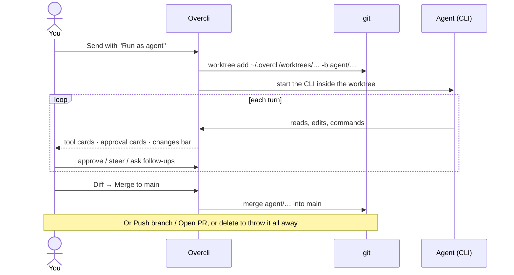
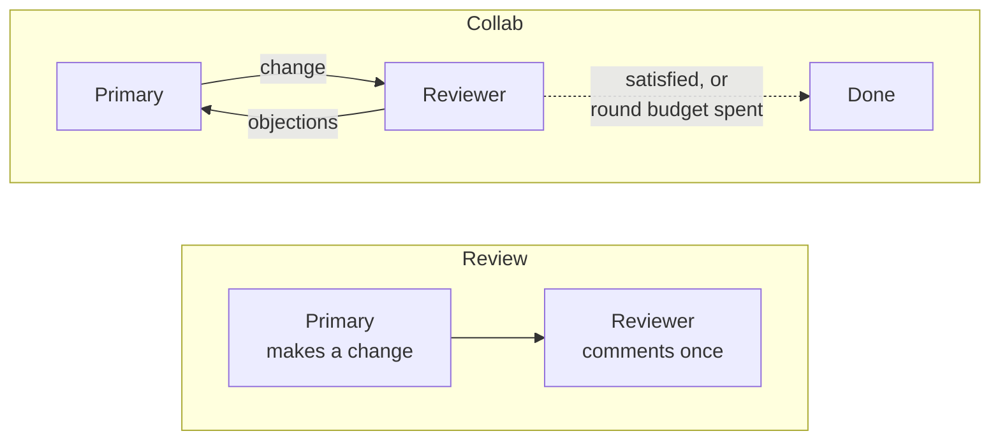

# Chats and agents

## The composer

```
┌───────────────────────────────────────────────────────────────┐
│ Ask Claude anything. @ to reference files · / for commands    │
│                                                               │
│ [permission] [backend] [model] [effort] [Rebound]             │
└───────────────────────────────────────────────────────────────┘
  [project / workspace]  [run mode]  [branch]
```

| Control | Notes |
|---|---|
| **Permission** | Plan · Default · Auto · Accept edits · Bypass. See [permission modes](concepts.md#permission-modes-what-it-may-do-without-asking). |
| **Backend** | A backend that's installed but signed out says so in the menu. |
| **Model** | The catalogue for that backend. For Ollama, only models you've pulled. |
| **Effort** | Claude and Codex only: Auto · Low · Medium · High · Max. |
| **Rebound** | Pick a reviewer preset — see below. |
| `@` | Reference a file — or a running [service](services.md)'s output. |
| `/` | The CLI's slash commands. |
| <kbd>↑</kbd>/<kbd>↓</kbd> | Recall previous prompts. |

Once a conversation is open, the header adds **response mode** (Full · Swift · Turbo · Warp — trade detail for speed), a **detail** toggle (Quiet · Summary · Detailed), **Commit**, **Diff** and a **⋯** menu (reset, compact, reveal worktree, rename/archive/delete).

## The life of an agent



### Watching what it did

- **Tool cards** — edits render as diffs, Bash as a terminal block, reads and todos as their own cards.
- **Approval cards** — when the CLI wants permission, it appears inline rather than as a modal.
- **The changes bar** — above the composer: `N files changed +a −d`, the branch (`⎇ agent/…`) and what it's compared against. Each file is tagged **committed**, **uncommitted** or **committed · edits**. Click a file to open its diff. If other files in the checkout are dirty, it says so (`+N other changes in this checkout`).

### Landing the work

Click **Diff** in the header:

| Button | When to use it |
|---|---|
| **Refresh** | After the agent made more changes |
| **Rebase onto {base}** | Main has moved on since the agent started |
| **Merge to {base}** | You're happy — bring it in (shown when your checkout is on the base branch) |
| **Push branch** | Share it (needs an `origin` remote) |
| **Open PR** | Push and run `gh pr create` (GitHub remotes) |
| **Check out locally** | Move the branch into your main checkout, remove the worktree, keep chatting there as a normal chat |

The header **Commit** button commits everything in the worktree (`git add -A`) with your message — <kbd>⌘↵</kbd> to commit.

### Cleaning up

- **⋯ → Rename, archive, or delete…** — *Archive* hides the conversation but keeps the worktree and branch. *Delete* removes both.
- **Clean up…** (sidebar, or <kbd>⌘K</kbd>) — sweeps old worktrees, sorted into **Safe to remove**, **Holds work**, **Still live** and **Not ours**.

Worktrees live in `~/.overcli/worktrees/`. Agent branches start with `agent/` — change the prefix in **Settings → Agents → Branch prefix**.

## Review and document agents

Choose **Review a branch** or **Document a branch** as the run mode, pick the branch, and Overcli checks it out *read-only* somewhere else on disk. Nothing it does can change a file.

From the header's **Review ▾** / **Docs ▾** menu you can **Promote to working agent** (give it write access to fix what it found), **Check out {branch} locally**, or dismiss it.

## Rebound: a second model reviews each turn

Pick a preset from the **Rebound** pill before you send:

| Preset | Cost | Good for |
|---|---|---|
| **Half-finished work check** | low | Catching TODOs, stubs and skipped steps |
| **Skeptical user** | low | "Does this actually work for someone using it?" |
| **Independent second opinion** | medium | A *different* CLI checks the work (needs a second CLI installed) |
| **Security review** | high | Risky changes |
| **Design review** | high | Structure and approach |
| **Cheap-and-paranoid** | high | A cheap model does the work, a strong one checks every turn |

Two modes:



Review presets that are about code only fire on turns that changed code. Fine-tune in the header's rebound panel: **Reviewer CLI**, **Mode**, **Reviewer model** (CLI default · Cheap · Smart) and **Persona**.

## Colosseum: one prompt, several models

*Labs → **Compare models**.* Then on a git project's **+** menu → **Colosseum…**

1. Write the prompt, pick a base branch, add two or more contenders (Claude, Codex or Gemini, optionally with a model).
2. Each contender works in its own worktree, in parallel.
3. In **Compare contenders**, read the diffs side by side, **Pick winner**, then **Merge / PR**.

It's the quickest way to learn which model is good at *your* codebase.
