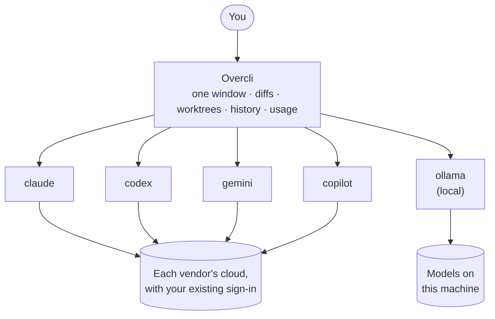
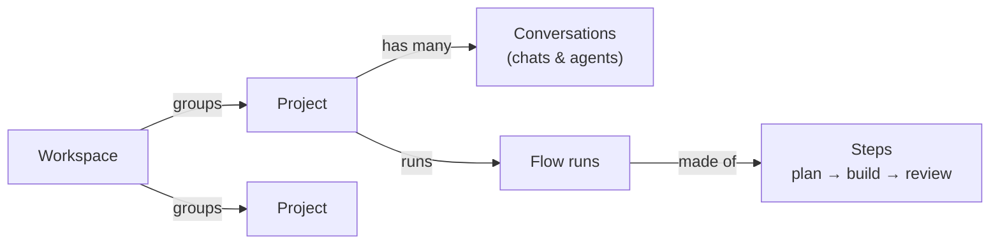
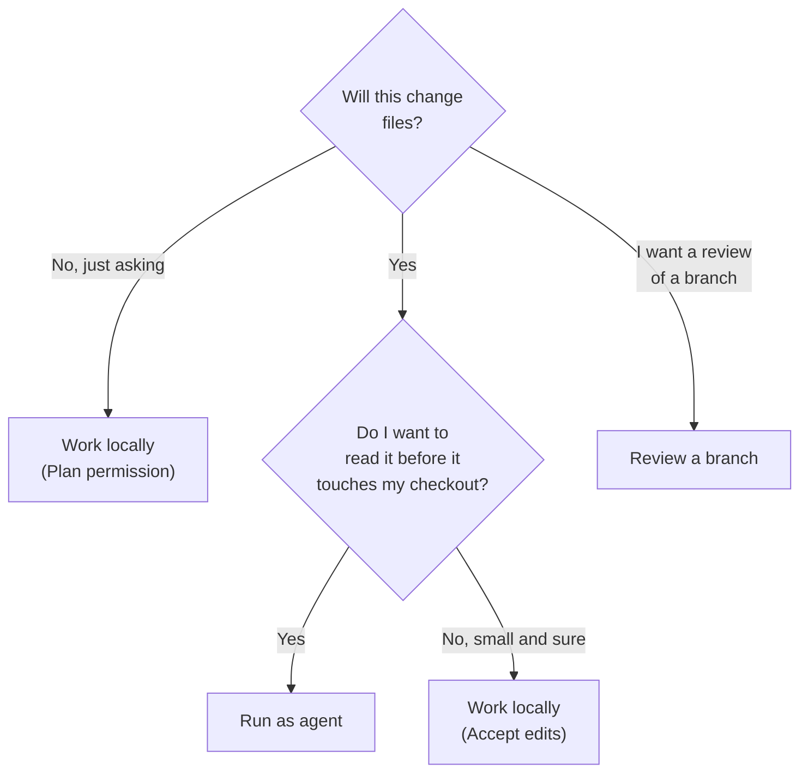

# How Overcli works

## Overcli sits over your CLIs

Overcli has no model of its own and no account. Each conversation starts (or reuses) the real CLI — `claude`, `codex`, `gemini`, `copilot` or `ollama` — and turns its output into one consistent window: message bubbles, diffs, terminal blocks and approval cards.

So:

- **No API keys, no new bill.** Whatever plan your CLIs are signed into is what you use.
- **Nothing is reinvented.** History is read straight from each CLI's own folder (`~/.claude/projects`, `~/.codex/sessions`, `~/.gemini/tmp`).
- **No telemetry.** Overcli sends no usage data anywhere.

## The four nouns

| | |
|---|---|
| **Projects** | A folder on your machine. A git repo unlocks agents and diffs. Chat with it, run tools, and keep one thread per task. |
| **Agents** | Build, review or doc agents run in their own git worktrees so your main checkout stays clean. |
| **Flows** | Chain steps into a pipeline — each its own model, role and tools — handing artifacts (plan → diff → review) step to step. |
| **Workspaces** | Group several projects into one workspace and fire agents that span every repo at once. |

## Run modes: where the work happens

Every send picks a run mode — the pill under the composer. It decides *which copy of your repository* the model can touch.

| Run mode | Where | Can it write? | Use it for |
|---|---|---|---|
| **Work locally** | Your actual checkout, on the branch you have open | Yes | Work you intend to keep right now; questions |
| **Run as agent** | A new worktree on a fresh branch | Yes, in isolation | Anything non-trivial — a run can go wrong at no cost |
| **Existing worktree** | A worktree that's already there, on its branch | Yes | Picking up an earlier agent's branch |
| **Review a branch** | A detached worktree | **No** — read-only | Pointing a model at code you didn't write |
| **Document a branch** | A detached worktree | **No** — read-only | "What would someone need to be told about this branch?" — comes back as markdown |

## Permission modes: what it may do without asking

Permission mode is per conversation, can change mid-thread, and is passed down to the CLI's own permission flags — so it means exactly what it says.

| Mode | Behaviour |
|---|---|
| **Plan** | Reads and plans only — no edits, no commands. *The default for new conversations.* |
| **Default** | Asks before every edit and every command. |
| **Auto** *(Claude only)* | Claude judges each call and only asks on the risky ones. |
| **Accept edits** | File edits apply without asking. Commands still ask. |
| **Bypass (dangerous)** | Nothing asks. Keep it to a worktree you can throw away. |

> **A good habit:** Plan to explore → Accept edits in an agent worktree to build → read the diff → merge.

Change the default for new conversations in **Settings → Agents → Default mode**.

## Two models on one problem

None of these need a second CLI. All of them get better with one.

- **Rebound** — a second model reviews each turn, or trades rounds with the first. → [Chats and agents](chats-and-agents.md#rebound-a-second-model-reviews-each-turn)
- **Colosseum** — the same prompt against several backends at once, each in its own worktree; keep the best diff. → [Chats and agents](chats-and-agents.md#colosseum-one-prompt-several-models)
- **Flows** — a saved pipeline: plan on a premium model, build on a cheaper or local one, review on a third. → [Flows](flows.md)

## Labs: features that are off until you want them

Some features are switched off for new installs so the app starts simple. Turn them on in **Settings → Labs** (or <kbd>⌘K</kbd> → **Labs…**).

| Lab | What it adds | New installs |
|---|---|---|
| **Workers** | Agents with a job description that run on a schedule, work through a queue and keep to a budget | On |
| **Compare models** | Colosseum | Off |
| **Services** | Start and watch your project's dev servers | Off |
| **Local models** | The Ollama dashboard | Off |
| **Orchestrator** | Batches of flow runs | Off |
| **Org workers · alpha** | Managers, org chart, Slack, the org server | Off |
