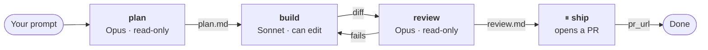
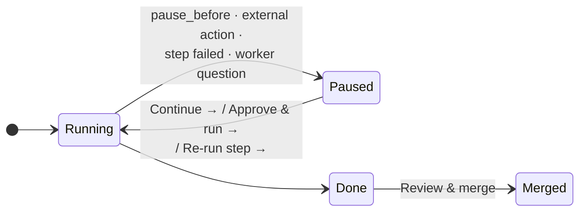

# Flows

A flow is a saved pipeline of steps. Each step has its own model, role and tools, and hands what it produced to the next. The classic shape:



Why bother, rather than one long chat?

- **The right model for each job.** A premium model plans and reviews; a cheaper or local one does the typing.
- **Fresh context per step.** Each step reads only what it needs — the plan, the diff — not a 200-message transcript.
- **Repeatable.** Same pipeline on the next ticket, and the one after.
- **Checkpoints where you want them.** Pause before anything leaves your machine.

## Your first flow in two minutes

1. Open the **Flows** tab → **+ New flow**.
2. Pick the **Build a feature** template (or **Solve a ticket**, **Code-review my branch**, **Add tests**…). Template models are matched to the CLIs that are healthy on your machine.
3. Click **Run**, type what it should work on, pick a project, press <kbd>⏎</kbd>.

Other places you can launch a flow: **Run a flow** on the start screen, **Run a flow…** in the sidebar (or star flows to pin them), select some text and choose **Run flow…**, or just <kbd>⌘K</kbd> and type its name.

## Three ways to make one

| | |
|---|---|
| **Start from a template** | Built-ins for code (*Build a feature*, *Research + design + build*, *Solve a ticket*, *Code-review my branch*, *Add tests*, *Refactor + verify*) and beyond (*Research a topic*, *Review my documents*, *Draft or update a policy*, *Clean up a spreadsheet*). |
| **Describe a flow** | Write what you want — *"Fix a ticket and open a PR"* — and click **✨ Draft this flow**. Your signed-in CLI drafts it and drops you in the editor. |
| **Browse library** | Install community flows from the [public registry](https://github.com/overcodelions/overcli-flow-registry). Add your own team registry in **Settings → Flows → Registries**. |

Inside the editor, **Edit with AI** revises the open draft from a sentence (<kbd>⌘↵</kbd>). Nothing is saved until you click **Save**.

## The editor

Each step card is a handful of choices:

| Field | Meaning |
|---|---|
| **Run by** | Which participant (a backend + model) runs this step. Steps run by the same participant share one conversation. |
| **Role** | *Plan the work*, *Implement the plan*, *Review the work*, … or *Custom* with your own prompt. |
| **Reads from** / **Produces** | What it takes in (`user_prompt` or earlier outputs) and what it hands on (`plan.md`, `diff`, `review.md`, `pr_url`…). |
| **Allowed actions** | Which tools it may use — e.g. Read/Grep only for a planner. |
| **Permission mode** | Same modes as chat. |
| **Pause before this step** | *Wait for me before running this step.* |
| **Verdict gate** | *This step must approve before continuing.* |
| **If the step fails** | Pause for me · Retry a different step (e.g. send a failed review back to **build**, up to N times) · Stop the whole run. |
| **Have another model critique this step** | A [rebound](chats-and-agents.md#rebound-a-second-model-reviews-each-turn) reviewer on just this step. |

Save to **User** (available everywhere) or **Project** (`.overcli/flows/`, so it's checked in with the repo and shared with your team).

### The YAML underneath

The right-hand pane always shows the canonical YAML — you can edit it directly. Here's the pipeline from the diagram above:

```yaml
# acme-fix-bug.yaml  (the file name is the flow's id)
name: Acme fix a bug
description: Plan, implement, review with retry, then ship after a human check.
input: user_prompt
default_prompt: "Fix ACME-123: login fails when the email has a plus sign"
participants:
  - { id: lead,    name: Lead,    backend: claude, model: claude-opus-5-5,   kind: primary }
  - { id: builder, name: Builder, backend: claude, model: claude-sonnet-5-5, kind: worker }
steps:
  - id: plan
    participant: lead
    role: planner
    inputs: [user_prompt]
    tools: [Read, Grep, Glob]
    output: plan.md
  - id: build
    participant: builder
    role: implementer
    inputs: [plan.md]
    tools: [Read, Grep, Glob, Edit, Write, Bash]
    permission_mode: acceptEdits
    output: diff
  - id: review
    participant: lead
    role: reviewer
    inputs: [plan.md, diff]
    tools: [Read, Grep]
    on_fail: { action: goto, target: build, max_retries: 2 }
    output: review.md
  - id: ship
    participant: builder
    role: shipper
    inputs: [plan.md, diff, review.md]
    tools: [Bash]
    effect: external
    pause_before: true
    output: pr_url
```

Rules worth knowing: at least one step reads `user_prompt`; a step can only read outputs of *earlier* steps; output names ending `.md` are markdown, `diff` is built from the real `git diff`, names ending `url` are links. Steps run one at a time.

## Watching a run



- **Where it runs** — **worktree** (a fresh branch, the default) or **main tree**. Change the default in **Settings → Flows → Run behavior**, along with a **cost ceiling per run**.
- **Each participant has a tab.** Chat with any of them mid-run — *your messages don't advance the flow*. Use **↯ Hold for {step}** (<kbd>⌘⏎</kbd>) to slip a note into the top of a later step's prompt. You can also swap a participant's model for the rest of the run.
- **Pause banners** tell you why it stopped and what the button will do: *Paused before next step*, *Approval required before external action*, *This step's instructions look risky*, *Paused — step needs attention*.
- **Review & merge** — the same Rebase / Merge / Push branch / Open PR controls as an agent.
- **↻ Re-run from here** to retry from any step.

The **Runs** tab lists every run; **Schedules** runs a flow on a timer.

## Run it in CI

From a flow's overview drawer, **Run in CI instead** (*Alpha*) → **Set up…** generates a GitHub Actions workflow or a Jenkinsfile that runs the flow with the [headless CLI](headless-cli.md). It writes the files; committing them is up to you.
