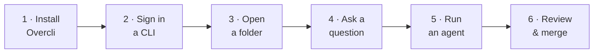
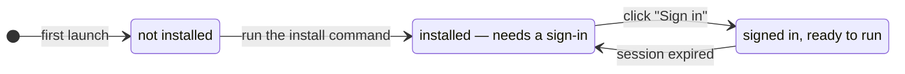
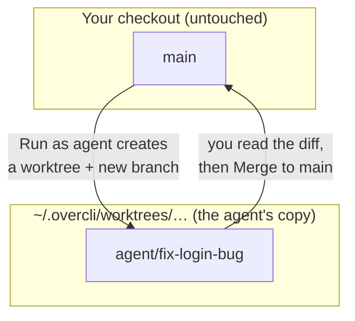

# Getting started

By the end of this page you will have:

1. a coding CLI signed in,
2. a project open,
3. asked a question about your code, and
4. had an agent make a change on its own branch — which you then read and merged.



## 1. Install Overcli

Download the build for your machine from the [latest release](https://github.com/overcodelions/overcli/releases/latest) (or [overcli.app](https://overcli.app)).

| Platform | First launch |
|---|---|
| **macOS** | Signed and notarized — opens normally. macOS asks to allow **"Overcli Safe Storage"** in the keychain: that's the app encrypting its own local data. Click **Always Allow**. |
| **Windows** | Not yet signed, so SmartScreen may warn. Click **More info → Run anyway**. |
| **Linux** | AppImage: `chmod +x` it, then run. Or install the `.deb`. |

## 2. Install and sign in to at least one CLI

Overcli drives CLIs you install yourself, using *their* sign-in. You need one; more is better (a second CLI makes a great reviewer).

| Backend | Install | Sign in |
|---|---|---|
| Claude | `npm install -g @anthropic-ai/claude-code` | `claude auth login` |
| Codex | `npm install -g @openai/codex` | `codex login` |
| Gemini | `npm install -g @google/gemini-cli` | `gemini auth login` |
| Copilot | `npm install -g @github/copilot` | `copilot login` |
| Ollama | Download from [ollama.com](https://ollama.com) | — runs locally |

You also need **git** — agents, worktrees and diffs are all git underneath.

You don't have to leave the app for this. The first screen shows a **"This machine"** list with a row per CLI and one for Git. Each row tells you where it stands:



Click **Sign in** on a row and Overcli opens a terminal with the right command. It checks again every few seconds — there's no need to restart. Lost track later? **Help → Setup — CLIs and Git** brings this screen back any time.

## 3. Open a project

A *project* is just a folder on your machine. Click **Open a folder** (or, later, **Add a place → Open a folder…** at the bottom of the sidebar).

Overcli looks at the folder and does the right thing:

- **A git repo** → added as a code project. Everything is unlocked.
- **A folder holding several repos** → offers to group them as a [workspace](workspaces-and-documents.md).
- **Mostly documents** → offers to show it as documents rather than code.

Don't have something to point it at? **Start something new** creates a fresh folder in `~/Documents/Overcli Projects/` for non-code work.

## 4. Ask your first question

You'll land on **"What should we build in {project}?"** with a composer at the bottom. Before you type, glance at the pills:

```
┌───────────────────────────────────────────────────────────────┐
│ Ask Claude anything. @ to reference files · / for commands    │
│                                                               │
│ [Plan] [Claude] [Model] [Auto effort] [Rebound]               │
└───────────────────────────────────────────────────────────────┘
  [my-project]  [Work locally]  [off main]
```

- **Permission mode** — starts on **Plan**: it can read and plan, but can't edit or run commands. Perfect for a first question.
- **Backend** and **Model** — which CLI and model answer.
- Below the composer: the **project**, the **run mode** and the **branch**.

Try one of the starter chips — **Explain this codebase** is a good first one — or type your own question. Press <kbd>Enter</kbd> to send, <kbd>Shift</kbd>+<kbd>Enter</kbd> for a new line, <kbd>Esc</kbd> to stop.

Every file the model reads, every command it runs and every edit it makes appears as its own card in the conversation, so you can see what it actually did.

## 5. Run an agent

Now let it change something — safely. Click the run-mode pill and choose **Run as agent**.



Overcli makes a second checkout of your repo (a git *worktree*) on a fresh branch and puts the agent there. Your own working copy is never touched, so a run that goes wrong costs nothing.

Set the permission pill to **Accept edits** (edits apply, commands still ask) and give it a small, real task:

> Add input validation to the signup form and a test for it.

When the CLI wants to run a command, an approval card appears in the conversation. Approve or deny it inline.

## 6. Review and merge

As the agent works, the **changes bar** above the composer counts files touched (`3 files changed +42 −7`). Click it to expand; click a file to see its diff.

When you're happy, click **Diff** in the conversation header. From there:

| Button | What it does |
|---|---|
| **Merge to main** | Merges the agent's branch into your base branch |
| **Rebase onto main** | Catches the branch up first if main has moved |
| **Push branch** / **Open PR** | Pushes it and opens a GitHub PR via `gh` |
| **Check out locally** | Moves the branch into your main checkout and keeps chatting there |

Not happy? Keep chatting in the same conversation to steer it, or delete the conversation (**⋯ → Rename, archive, or delete… → Delete…**) to throw the worktree and branch away.

## You're set up. What next?

- **Get a second opinion on every turn** → pick a **Rebound** preset in the composer. See [Chats and agents](chats-and-agents.md#rebound-a-second-model-reviews-each-turn).
- **Make the plan → build → review loop repeatable** → [Flows](flows.md).
- **Work across several repos at once** → [Workspaces](workspaces-and-documents.md).
- **Want the mental model first?** → [How Overcli works](concepts.md).
- **Press <kbd>⌘K</kbd>** and type anything — chats, flows, projects and actions are all one search away.
