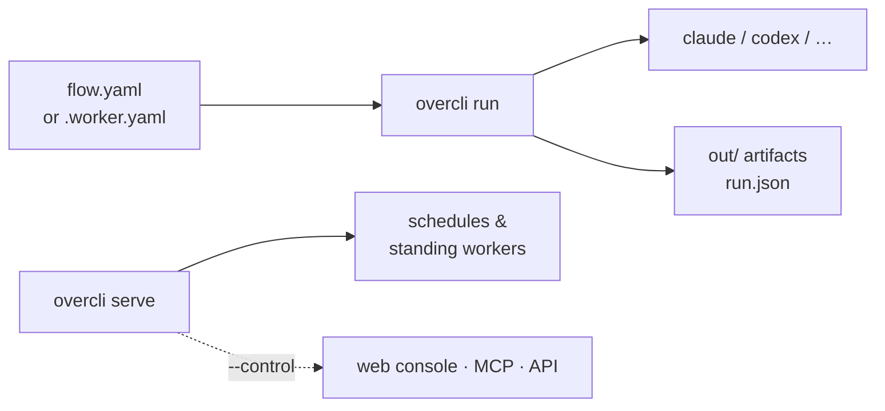

# Headless CLI *(alpha)*

`overcli` runs the same flows and workers as the app, from a terminal — on plain Node, no window. Use it in CI, on a box you own, or to keep schedules running without the app open.

> The CLI package isn't published publicly yet. Today it's built from this repo (`dist/cli/index.js`).



## Run a flow once

```bash
overcli run .overcli/flows/acme-fix-bug.yaml \
  --cwd . \
  --input "Fix ACME-123" \
  --permissions allow-list --allow-tool Read,Grep,Edit,Write,Bash \
  --run-in worktree \
  --artifacts-dir out --json > run.json
```

| Flag | Default | |
|---|---|---|
| `--cwd` | `$GITHUB_WORKSPACE`, `$WORKSPACE`, then `.` | The project to run against |
| `--input` | the flow's `default_prompt` | The prompt |
| `--permissions` | `deny` | `deny` · `allow-list` · `auto-approve` — overrides the flow's tools |
| `--run-in` | `cwd` | or `worktree` |
| `--model-override` | — | e.g. `ollama=claude:claude-sonnet-5-5` for machines without Ollama |
| `--trust` | — | For worker files: `probation` · `trusted` · `autonomous` |
| `--timeout` | — | Seconds |

A file containing `kind: worker` runs as a worker shift; anything else runs as a flow.

**Exit codes:** `0` succeeded · `1` failed · `2` paused, needs a human · `3` preflight failed · `4` bad arguments · `5` timed out.

## Keep things running

```bash
overcli serve --state-dir "$HOME/Library/Application Support/Overcli"
```

Runs your saved schedules and standing workers with no window. Pass `--state-dir` to share the app's flows and workers — otherwise the CLI uses its own `~/.overcli` state.

Add `--control 7420` for the org server: a web console at `/`, MCP at `/mcp`, a JSON API at `/api`, all behind tokens from `overcli tokens create`. A bare port listens on localhost only.

## Use it from another agent

```json
{ "command": "overcli", "args": ["mcp"] }
```

Exposes `list_flows`, `run_flow` and `get_run` over MCP — so Claude, Codex or any MCP client can kick off your flows. It can't edit, delete or approve anything.

## Generate a CI job

In the app, a flow's overview → **Run in CI instead** → **Set up…** writes either `.github/workflows/overcli-flow-<name>.yml` or `Jenkinsfile.overcli-flow-<name>`, plus the flow under `.overcli/flows/`. The job runs on demand with a `prompt` input and uploads `out/` and `run.json`. You'll need an `ANTHROPIC_API_KEY` secret (CI has no signed-in CLI), and to commit the files yourself.
