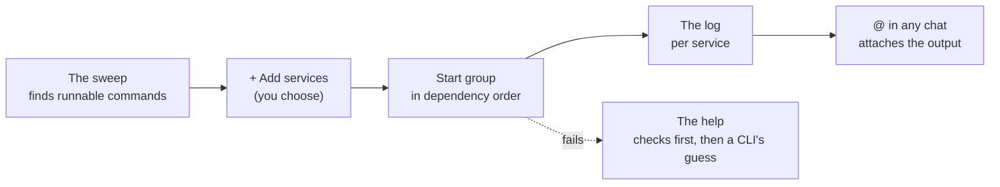

# Services

*Turn on in **Settings → Labs → Services**, or click **Turn on Services** when the start screen notices your project has things it can run.*

A service is the command your project needs running — `npm run dev`, a Spring Boot app, `docker compose up`. Overcli finds them, starts them in the right order, keeps the logs, and lets you hand a log straight to an agent.

## What it knows

Node (npm/pnpm/yarn/bun), Vite, Angular, Spring (Gradle & Maven), Python, Go, Rust, Ruby, Elixir, PHP, Deno, .NET and Docker Compose.

## Using it

1. Open the **Services** tab → **+ Add services**. Nothing is added until you say so.
2. **Start group** / **Stop group**, or **Stop** / **Restart** per service. Filter by **All · Running · Problems**.
3. In any chat, type `@` and pick a running service to attach its output — *"why is this failing?"* with the actual log.

Per service, **Settings** has:

- **How it starts** — the command, what "ready" looks like, what happens on code changes.
- **Where it runs** — which checkout. Use **Run this from…** to point it at an agent's worktree and try the agent's branch before you merge.
- **Startup order** — **Waits for** other services.
- **Machine values / Shared values** — environment variables. Secrets go in the system keychain.

Nothing starts itself. By default everything stops when Overcli quits (**Settings → Services**).
