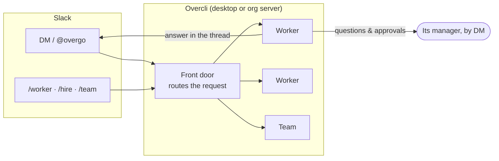
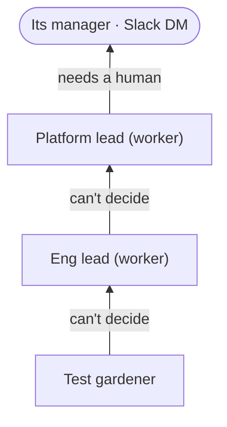

# Slack and the org server *(alpha)*

*Turn on **Settings → Labs → Org workers · alpha**. This adds **Settings → Your org**, and Manager / Who may ask it fields on every worker.*

The org layer lets [workers](workers-and-teams.md) behave like members of a team: they have managers, escalate questions up a chain, and can be reached from Slack. Run it from the desktop app for yourself, or on a shared server for everyone.

## Managers and escalation

On each worker:

- **Manager** — a person (with their Slack member ID).
- **Reports to** — another worker, or *Nobody — top of its branch*.
- **Who may ask it** — Only its manager · Its team · Everyone in the org.

When a worker hits a question it can't answer, the question climbs the **Reports to** chain (up to four hops). Each boss may answer or pass it up; only then does it reach a person — the nearest manager.

The **Org** chart (rail footer) shows it all. Drag a worker onto another to change who it reports to.

## Setting up Slack

Overcli uses Socket Mode, so nothing needs to reach your machine from outside.

1. At [api.slack.com/apps](https://api.slack.com/apps): **Create New App → From a manifest**, and paste [`src/main/slack/slack-app-manifest.yml`](../../src/main/slack/slack-app-manifest.yml). It creates a bot called **overgo** with the scopes and events it needs.
2. Install it to your workspace and copy the **Bot token** (`xoxb-…`).
3. **Basic Information → App-Level Tokens** → create one with `connections:write` and copy it (`xapp-…`).
4. In Overcli: **Settings → Your org → Slack · alpha**. Paste both tokens (they're stored in the OS keychain), set **Your Slack member ID**, turn on **Send questions and approvals to managers in Slack**, and click **Test bot token**.

Run only one Overcli per Slack app. On the desktop, the bot only takes requests from you; on the org server it takes them from anyone in the workspace.

## Using it from Slack

**Just ask.** DM the bot or @mention it. It routes the request to the right worker or team (asking *who should take this?* if unsure), may first point you at existing work, and answers general questions itself. Replies come back in the same thread. Click **🔔 Notify me** (or say *"let me know"*) to follow a thread.

**Slash commands:**

| Command | |
|---|---|
| `/worker` | List workers |
| `/worker waiting` | Questions, approvals and proposed work waiting on you |
| `/worker <name> <request>` | Send it an errand — the answer comes by DM |
| `/worker <name> pause` · `resume` | |
| `/worker <name> track ACME-412` | Follow a ticket |
| `/worker <name> edit` | Change its job (or say what should change), trust, schedule and budget *(org server)* |
| `/worker <name> learn` | Have it go through its tools and learn what its job needs *(org server)* |
| `/worker <name> tools` · `tools add <tool>: why` | Its tools; give it one, or ask an admin *(org server)* |
| `/hire <job description>` | Draft a new worker in a DM thread |
| `/team` · `/team <name>: <task>` · `/team new <purpose>` | Teams from Slack |
| `/overgo digest` | Your week with your workers so far *(org server)* |
| `/overgo join` | Ask an admin to let you in |

Managers get proposals, finished shifts (with files attached), questions and external-action approvals as DMs with **Approve** / **Reject** buttons. On the org server an approval also has **Always allow**: that step of that flow runs without asking from then on.

**Handing a thread on.** In a worker's thread, start a reply with another worker's name ("Triage will need to…", "ask Triage to…") and that worker takes the thread over, with what was said so far. Questions about how the product works go to a worker that reads the code: one whose repo or workspace holds it.

## The org server

The same engine, headless, so workers run when your laptop is closed and everyone on the team can use them. It's `overcli serve --control` from the [headless CLI](headless-cli.md), with a web console for triggers, tools and repos. See [`deploy/README.md`](../../deploy/README.md) for the Docker setup.

Things only the server console manages:

- **Triggers** — wake a worker when something changes in a tool, when another system posts to a webhook, or when something happens in Slack.
- **Tools** — install MCP tools once; secrets are never shown back, and a sign-in check confirms which account they act as.
- **Repos** — connected once and cloned on the server. Workers push branches, never the default branch; a person opens the PR.
- **Access** — each worker's tools and their scope, how much it does alone, standing approvals and checkpoints, on its **Access** tab. Managers give cleared tools at once and ask an admin for the rest.
- **What it knows** — a worker goes through its tools once, read only, and reads its notes before every run. Admins also keep a **Handbook** every worker reads.
- **History** — every change to a worker's job, tools, trust and settings, with **Restore**.
- **Tool health** — a tool whose key expired or whose API was retired alerts the admins in Slack, and the Monday digest tells managers and admins how the week went.

The server's own docs, at **/docs** on its address, cover these: [using workers](../../deploy/docs/using.md), [for managers](../../deploy/docs/managers.md), [for admins](../../deploy/docs/admins.md) and the [security model](../../deploy/docs/security.md).
