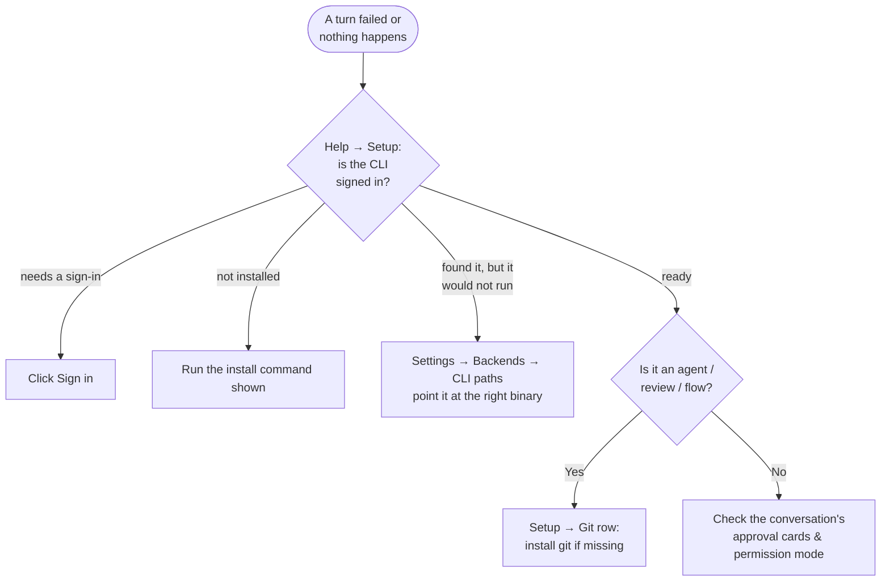

# Troubleshooting & reference

## Something's wrong

| Symptom | Fix |
|---|---|
| **Open a folder** is greyed out | No CLI is ready yet. Set one up first — the button unlocks the moment one is. |
| A CLI shows **installed — needs a sign-in** | Click **Sign in**, or run its login command (`claude auth login`, `codex login`, `gemini auth login`, `copilot login`). |
| A CLI shows **found it, but it would not run** | Usually a PATH or Node version issue. **Settings → Backends → CLI paths** lets you point at the binary, then **↻ Re-check health**. |
| **Every CLI is switched off** | **Settings → Backends → Enabled backends**. |
| **Run as agent** isn't offered | The project isn't a git repo (or git isn't installed). Check **Help → Setup — CLIs and Git**. |
| The model keeps asking permission | It's on **Default**. Switch to **Accept edits** (in an agent worktree), or **Auto** on Claude. |
| The model won't edit anything | It's on **Plan** — the default for new conversations. |
| A Codex model is "unavailable" | Overcli retries on the next model down automatically (**Settings → Advanced → Resilience**). |
| Merge isn't offered in **Diff** | Your main checkout isn't on the base branch. **Rebase**, **Push branch** or **Open PR** still work. |
| Lots of old worktrees | <kbd>⌘K</kbd> → **Clean up…** |
| A worker didn't run | Workers only run while the app is open (or on the org server). Check it isn't **Paused**, out of budget, or the crew isn't **away**. |
| A flow is paused | Read the banner — it says why and what the button does. |
| A feature in these docs is missing | It may be a Lab: **Settings → Labs**. |
| *Org server:* a tool shows **Won't start** and its error says "Cannot find module" | An `npx` tool whose first download was cut off halfway. The server now installs npx tools ahead of time and repairs a broken install by itself, at startup and every 30 minutes; press **Check all** (or **Check again**) on Setup → Tools after a few minutes. |
| *Org server:* a tool shows **Can't sign in since…** | Its key expired or lost access. Change its keys on Setup → Tools; the alert clears on the next call that works, or press **Mark fixed**. |
| *Org server:* a worker's **History** is empty, or **What it knows** says it hasn't been through its tools | Both start after the upgrade that added them: history records from the first change after it, and a worker hired before it learns its tools when someone presses **Learn its tools** (or `/worker <name> learn`). |
| *Org server:* a worker says it couldn't open a page | With **Safe fetches**, it only opens addresses from the request, a search or a page it read. Ask it to search first, or list the site under **Setup → Hiring → Your own sites**. |

Still stuck? **Help → Report an Issue**.

## Keyboard shortcuts

| Keys | |
|---|---|
| <kbd>⌘K</kbd> | Command palette — chats, flows, projects, actions |
| <kbd>⌘P</kbd> | Find a file in the project |
| <kbd>⌘N</kbd> | New conversation |
| <kbd>⌘\</kbd> | Toggle sidebar |
| <kbd>⌘J</kbd> | Show or hide the terminal |
| <kbd>⌘,</kbd> | Settings |
| <kbd>⌘/</kbd> or <kbd>?</kbd> | All shortcuts |
| <kbd>⌘←</kbd> / <kbd>⌘→</kbd> | Back / forward |
| <kbd>⌘S</kbd> | Save file |
| <kbd>⌘⇧D</kbd> | Toggle Diff / File view |
| <kbd>⌘</kbd>-click | Go to definition |
| <kbd>⌘1</kbd>–<kbd>⌘9</kbd>, <kbd>⌥⌘←/→</kbd> | Editor tabs |
| <kbd>Esc</kbd> | Stop a running turn / close a sheet |

**In the palette:** <kbd>Tab</kbd> switches scope (All · Chats · Flows · Places · Actions · Archived), <kbd>⌘R</kbd> renames, <kbd>⌘⌫</kbd> archives, <kbd>⇧↵</kbd> searches all work.

## Where things live

| What | Where |
|---|---|
| App data (projects, settings, flows, runs, workers) | macOS `~/Library/Application Support/Overcli/` · Windows `%APPDATA%\Overcli` · Linux `~/.config/Overcli` |
| Settings and projects | `overcli.json` in the folder above |
| Your flows | `flows/` in app data, or `<project>/.overcli/flows/` |
| Flow runs | `flow-runs/` in app data |
| Worker deliverables | `worker-files/` in app data |
| Agent worktrees | `~/.overcli/worktrees/` |
| Documents projects | `~/Documents/Overcli Projects/` |
| Conversation transcripts | Each CLI's own folder — `~/.claude/projects`, `~/.codex/sessions`, `~/.gemini/tmp` |
| Headless CLI state | `$OVERCLI_HOME` or `~/.overcli` |

## Settings at a glance

| Tab | Highlights |
|---|---|
| **General** | Theme, interface size, show cost per turn |
| **Backends** | Enabled backends, preferred backend, CLI paths & health |
| **Models** | Default model and reasoning effort per backend |
| **Agents** | Branch prefix, default permission mode |
| **Flows** | Worktree by default, sandbox writes, cost ceiling, model tiers, registries |
| **Services** | Stop everything on quit |
| **Your org** | Org server and Slack *(alpha)* |
| **Labs** | Workers, Compare models, Services, Local models, Orchestrator, Org workers |
| **Advanced** | Auto-downgrade, idle session release, webhook notifications, update channel |
