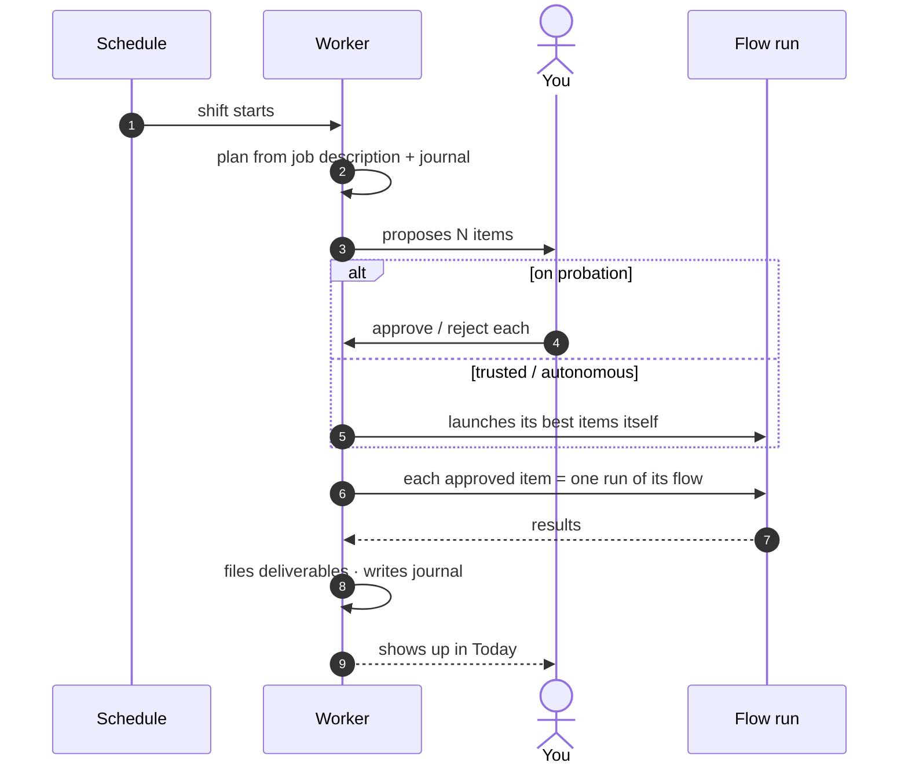
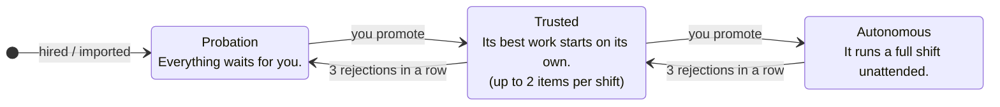
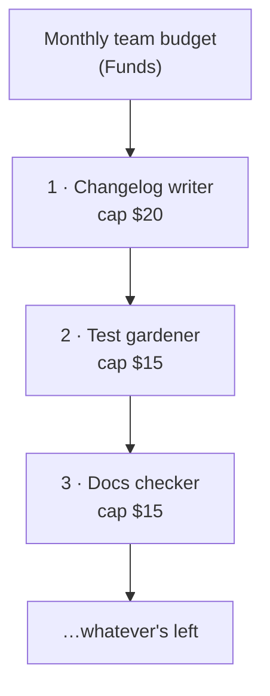
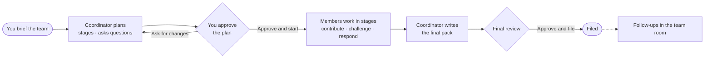

# Workers and teams

A **worker** is a standing agent with a job description. It wakes on its own schedule, proposes work, does what you approve, files what it produces and keeps a journal — inside a budget you set once.

A **team** is several workers on one task, with a coordinator who plans the stages.

> Workers are on by default (**Settings → Labs → Workers**). Workers only run while the app is open — or on the [org server](slack-and-org.md) if you want them always on.

## How a worker's shift works



## Hire one

You need a project first — a worker is hired onto one. Open the **Workers** tab, then **✨ Hire a worker**.

1. **Describe the job.** For example: *"Every weekday morning, look at yesterday's merged PRs in acme-api and write a changelog entry for anything user-facing."* Pick the project under **Works against**. There are template tabs for **For the codebase** and **Beyond code**.
2. **Start onboarding.** Your CLI asks up to three rounds of questions, then drafts the contract. In a hurry? **Draft it now**.
3. **Review the contract**, then **Hire**.

The contract fields that matter most:

| Field | What it controls |
|---|---|
| **Job description** | The worker plans every shift from *only* this plus its journal. Be specific. |
| **Shift cadence** | **At a time of day**, **Every N minutes** (15 minimum), **Cron**, or **On demand** (never wakes itself, but you can message it). |
| **Flow for launched items** | Each approved proposal becomes one run of this [flow](flows.md). |
| **Items per shift** | Up to 10. |
| **Budget / month** | Shifts stop when it's spent. |
| **Heartbeat model** | The model that *plans* shifts — keep it cheap. |
| **Runs in** | A fresh worktree (safe) or the working copy (only once it's autonomous). |
| **Tools it may reach for** | Which MCP tools it may use. |

You can also **Add by hand** (write the contract yourself) or **Import…** a `.worker.yaml` someone shared.

## Trust: probation → trusted → autonomous

Every hire starts on probation. You promote it when it's earned it.



Promote from the worker's **Settings** tab → **Trust**. Pauses written into its flow (`pause_before`) still stop at any trust level, and anything that leaves your machine (push, publish, send) waits for approval unless you tick **Allow external actions without approval**.

## Your daily loop: Today

The **Today** view collects everything:

- **Needs you** — proposals, questions and paused runs. **Approve all** or open each one (**Launch** / **Reject**). Rejected titles are never proposed again.
- **Working** — what's running now.
- **Ask the crew** — type a request (or `@Name …`) and Overcli routes it to the right worker. If nobody fits, it offers **Hire someone for this**.

On a worker's page:

| Tab | |
|---|---|
| **Chat** | Its desk. Every message is an errand: it answers or proposes work. Start with `/run <the work>` to skip straight to its flow. |
| **Shifts** / **Tasks** | What it planned and ran. |
| **Files** | Its filing cabinet — deliverables per run. |
| **Journal** | Shifts, proposals, approvals, rejections, your notes. |
| **Stats** | Spend, priority, rejection streak. |
| **Settings** | Trust, pause/resume, **Share**, **Start fresh**, **Fire**. |

**Run shift now** works a shift out of schedule. The **Shifts** calendar in the rail footer shows the week; **Go away** pauses the whole crew until you're back.

## Budget: one pot, paid down a priority list



Each worker has its own cap, and **Funds** (rail footer) holds one shared monthly pot. A worker may spend only what's left after everyone above it is funded to its cap — so the total crew spend is one number you approve once. Drag to reorder **Funding priority**; **Distribute by priority** sets the caps for you. Pausing a worker releases its share.

## Putting finished work in the folder

On a [documents project](workspaces-and-documents.md#documents-projects-overcli-without-a-repo), turn on **Put finished work in the project folder**. Finished documents are copied to:

```
<project>/<Worker name>/<YYYY-MM-DD> <job title>/
```

Files are added, never overwritten, and a version is saved so you can undo.

## Sharing a worker

**Settings → Share → Save file…** exports `<name>.worker.yaml`: the job, cadence, caps, budget and its full flows. It does *not* carry trust (imports always start on probation), history, or your project path.

## Teams

A team puts workers together on one task. A coordinator plans the stages; you approve the plan.



- **Make one:** Workers → **New team…**. Answer *What should this team produce?*, then **Suggest a team** (the coordinator picks from your crew and proposes hires) or **Add from crew** yourself. Up to 8 members.
- **Brief a task** in the team's desk: what you want, what it's for, what you want back. Attach specs, screenshots or PDFs.
- **One shared branch** per task (`team/<task>`) in every repo; one **shared folder** for files. From the code card you can **Push**, **Open pull request** or **Merge**.
- **A budget per task** is checked before every stage. If it runs out, the task waits for you.
- **Afterwards**, ask the team follow-up questions in its room, or `@Name redo …` to hand work back to one member.
