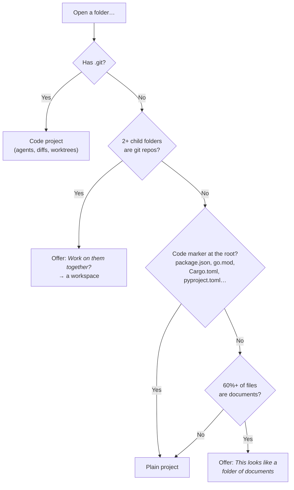
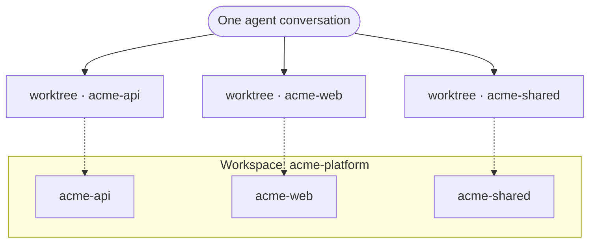

# Workspaces and documents

## What happens when you open a folder

Overcli inspects a folder before adding it, so you rarely have to tell it what it is.



Changed your mind? The place's **⋯** menu has **Show as documents…** / **Show as files…**.

## Workspaces: projects of projects

A workspace groups several repos so one conversation — or one agent — can work across all of them. A polyrepo that feels like a monorepo.



### Creating one

Any of these work:

- **Open a folder of repos** and choose **Work on them together**.
- **Add a place → New workspace…** (once you have two or more projects), or <kbd>⌘K</kbd> → **New workspace…**
- From the composer's project pill on a project: **Work on {project} and… → + {other}**. That creates (or reuses) a workspace with both and starts a chat.

In **New workspace** you can add **Workspace instructions**. They're added to `CLAUDE.md` / `AGENTS.md` / `GEMINI.md` for that workspace, so every CLI gets the same briefing.

### Agents across repos

**Run as agent** on a workspace makes one worktree per member repo. When you review, each repo shows its own state — **Merged**, **Uncommitted changes**, **Committed, not merged**, **No changes** — with a **Merge to {base}** per repo, or **Check out all locally**.

Add or remove repos later with the place's **⋯ → Edit member projects…**

> Review and Document agents work on a single repo, not a workspace.

## Documents projects: Overcli without a repo

Not everything is code. A documents project is for reports, policies, spreadsheets, research — anything you'd keep in a folder.

**Start something new** asks two things — *What should we call it?* and *What do you want to get done?* — and creates:

```
~/Documents/Overcli Projects/
└── Q3 board pack/
    ├── BRIEF.md                 ← what you said you want
    └── (your files)             ← one flat folder — no inbox/ or output/
```

What you get:

- **A real folder** you can open in Finder like any other.
- **Undo history.** A version is saved every time something finishes (it's git underneath, set up for you — you never have to touch it).
- **Somewhere for workers to file** what they produce. See [Workers](workers-and-teams.md#putting-finished-work-in-the-folder).
- **Starter actions for documents**: *Review what's here*, *Summarize the data*, *Build a report*, *Investigate something* — and starter [flows](flows.md) like **Review my documents**, **Draft or update a policy** and **Clean up a spreadsheet**.
